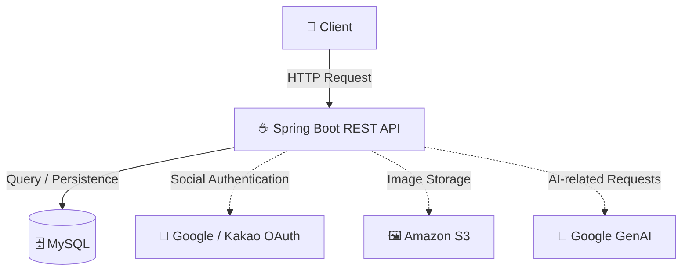

# 💬 QUOTEME Backend

> **당신의 일상을 명언으로, 소셜 플랫폼 QUOTEME**

QUOTEME는 소중한 사람들과 함께 당신의 일상을 특별하게 나눌 수 있도록 돕는 소셜 서비스입니다.

이 저장소는 QUOTEME의 사용자 인증, 프로필, 명언, 친구 관계 및 다양한 서비스 기능을 제공하는 **백엔드 API 서버**입니다.

<p align="left">
  
  
  
  
  
</p>

<p align="left">
  <a href="./API_SPEC.md">📡 API 명세서</a> ·
  <a href="./DEPLOY_GUIDE.md">🚀 배포 가이드</a> ·
  <a href="https://github.com/QuoteME-2025-LIKELION/Backend">📦 GitHub 저장소</a>
</p>

---

## 📑 목차

- [✨ 프로젝트 소개](#-프로젝트-소개)
- [🚀 주요 기능](#-주요-기능)
- [🛠️ 기술 스택](#️-기술-스택)
- [🏗️ 시스템 구성](#️-시스템-구성)
- [📂 프로젝트 구조](#-프로젝트-구조)
- [⚙️ 개발 환경 설정](#️-개발-환경-설정)
- [🔐 환경 변수 설정](#-환경-변수-설정)
- [▶️ 실행 및 테스트](#️-실행-및-테스트)
- [📡 API 문서](#-api-문서)
- [🚢 배포](#-배포)
- [🛡️ 보안 가이드](#️-보안-가이드)
- [🤝 개발 및 기여](#-개발-및-기여)

---

## ✨ 프로젝트 소개

QUOTEME는 사용자가 명언과 생각을 기록하고, 다른 사용자와 연결되며, 콘텐츠를 함께 나눌 수 있도록 설계된 소셜 서비스입니다.

백엔드는 클라이언트의 HTTP 요청을 처리하고, 서비스 데이터와 사용자 인증을 관리하며, 외부 서비스와 연동하는 API를 제공합니다.

### 🎯 프로젝트 목표

- **Connect** — 친구 관계를 통해 사용자 간 연결을 지원합니다.
- **Collect** — 명언과 콘텐츠를 기록하고 아카이빙할 수 있도록 합니다.
- **Share** — 명언과 생각을 다른 사용자와 나눌 수 있도록 합니다.
- **Discover** — 다양한 서비스 기능을 통해 새로운 콘텐츠와 상호작용을 지원합니다.

## 🚀 주요 기능

| 기능 | 설명 |
|---|---|
| 🔑 인증 및 계정 | 회원가입, 로그인, 게스트 로그인, 토큰 재발급, 로그아웃 |
| 👤 프로필 | 내 프로필 조회·수정, 다른 사용자 프로필 조회, 계정 관리 |
| 💬 명언 | 명언 관련 콘텐츠 조회 및 작성, 피드와 상호작용 |
| 🗂️ 아카이브 | 명언을 모아 보고 관련 기록을 조회하는 기능 |
| 🤝 친구 | 친구 요청과 친구 관계 관리 |
| 👥 그룹 | 그룹 관련 기능 및 그룹 단위 서비스 지원 |
| 🔔 알림 | 서비스 내 알림 기능 |
| ⚙️ 설정 및 부가 기능 | 사용자 설정과 기타 상호작용 기능 |
| 🤖 AI 연동 | Google Gemini API를 이용한 관련 기능 |
| 🖼️ 이미지 저장 | Amazon S3 연동을 통한 이미지 저장 지원 |

세부 기능과 지원하는 API는 [API 명세서](./API_SPEC.md)를 참고하세요. 기능별 세부 동작은 실제 구현과 명세서를 함께 확인해야 합니다.

---

## 🛠️ 기술 스택

| 분류 | 기술 |
|---|---|
| Language | Java 21 |
| Framework | Spring Boot 3.2.10 |
| Build Tool | Gradle Wrapper |
| Database | MySQL |
| ORM | Spring Data JPA, Hibernate |
| Security | Spring Security, JWT |
| Social Login | Spring Security OAuth2 Client |
| API | Spring MVC, REST API |
| API Documentation | Springdoc OpenAPI |
| AI Integration | Google GenAI |
| Object Storage | Amazon S3 |
| Container | Docker, Docker Compose |
| Infrastructure | AWS |
| Web Server / Reverse Proxy | Nginx |

> 기술 목록은 저장소의 빌드 설정 및 구성 파일을 바탕으로 정리했습니다. 실제 실행 환경과 각 기능의 활성화 여부는 애플리케이션 설정을 기준으로 확인하세요.

---

## 🏗️ 시스템 구성

다음은 QUOTEME 백엔드의 주요 구성 요소를 이해하기 위한 개념도입니다.



- 클라이언트는 백엔드 API를 통해 서비스 기능을 이용합니다.
- 백엔드는 MySQL을 이용해 서비스 데이터를 관리합니다.
- OAuth, S3 및 Google GenAI는 해당 기능을 사용하는 흐름에서 연동됩니다.

위 그림은 주요 구성 요소를 보여주는 개념도이며, 상세한 네트워크 구성이나 내부 코드 계층을 나타내는 배포 아키텍처는 아닙니다.

---

## 📂 프로젝트 구조

```text
Backend/
├── .claude/                  # Claude 관련 프로젝트 설정
├── .github/                  # GitHub 설정 및 워크플로
├── deploy/                   # 배포 관련 파일
├── gradle/
│   └── wrapper/              # Gradle Wrapper
├── nginx/                    # Nginx 관련 설정
├── scripts/                  # 환경 초기화 및 운영 스크립트
├── src/                      # 애플리케이션 소스 및 테스트
├── .env.example              # 환경 변수 예시
├── API_SPEC.md               # API 명세서
├── DEPLOY_GUIDE.md           # AWS 배포 가이드
├── Dockerfile                # Docker 이미지 빌드 설정
├── docker-compose.prod.yml   # 운영 환경 Docker Compose
├── build.gradle              # 플러그인 및 의존성 설정
├── settings.gradle           # Gradle 프로젝트 설정
├── gradlew                   # Gradle Wrapper (macOS / Linux)
└── gradlew.bat               # Gradle Wrapper (Windows)
```

프로젝트의 내부 패키지와 실제 요청 처리 흐름을 확인하려면 `src/` 아래의 구현을 참고하세요.

---

## ⚙️ 개발 환경 설정

### 1. 사전 요구 사항

로컬 개발을 시작하기 전에 다음 환경을 준비합니다.

| 도구 | 요구 사항 |
|---|---|
| Git | 저장소 클론 |
| Java | JDK 21 |
| MySQL | 로컬 또는 접근 가능한 개발용 DB |
| IDE | IntelliJ IDEA, Eclipse, VS Code 등 |

Docker를 사용한 실행이나 배포 환경 테스트에는 Docker 및 Docker Compose도 필요합니다.

### 2. 저장소 클론

```bash
git clone https://github.com/QuoteME-2025-LIKELION/Backend.git
cd Backend
```

### 3. Java 버전 확인

```bash
java -version
```

Java 21이 사용되는지 확인하세요.

### 4. 환경 변수 준비

루트 디렉터리의 `.env.example`에서 필요한 환경 변수와 이름을 확인합니다.

```bash
cp .env.example .env
```

위 명령은 환경 변수 파일의 작업용 사본을 만드는 단계입니다. `.env` 파일을 생성했다고 해서 Spring Boot가 해당 파일을 자동으로 읽는 것은 아닙니다. 실제 프로젝트 설정에 따라 IDE의 실행 구성이나 셸 환경 변수 등을 통해 값을 주입해야 할 수 있습니다.

**로컬 개발 환경에 맞게 데이터베이스 연결 정보와 필요한 외부 서비스 설정을 구성하세요. 운영 환경의 값을 그대로 사용하지 마세요.**

### 5. 애플리케이션 실행

macOS / Linux:

```bash
./gradlew bootRun
```

Windows:

```bat
gradlew.bat bootRun
```

실행 전에 데이터베이스 연결 정보, 필수 시크릿 및 활성화할 Spring 프로필을 확인하세요. 로컬 환경에서 `prod` 프로필을 무조건 사용하지 말고, 실제 설정 파일과 실행 조건에 맞는 프로필을 선택해야 합니다.

> 최초 실행이 실패하면 오류 로그를 확인하고, 누락된 환경 변수나 데이터베이스 연결 상태부터 점검하세요.

---

## 🔐 환경 변수 설정

환경 변수 템플릿은 [`.env.example`](./.env.example)에서 확인할 수 있습니다.

| 분류 | 주요 환경 변수 |
|---|---|
| Spring Profile | `SPRING_PROFILES_ACTIVE` |
| Database | `DB_HOST`, `DB_PORT`, `DB_NAME`, `DB_USERNAME`, `DB_PASSWORD` |
| Application / JWT Secret | `SECRET_KEY`, `JWT_SECRET_KEY` |
| AI | `GEMINI_API_KEY` |
| Google OAuth | `GOOGLE_CLIENT_ID`, `GOOGLE_CLIENT_SECRET` |
| Kakao OAuth | `KAKAO_CLIENT_ID`, `KAKAO_CLIENT_SECRET` |
| OAuth Redirect | `CUSTOM_OAUTH2_REDIRECT_BASE` |
| CORS | `CUSTOM_FRONTEND_ALLOWED_ORIGINS` |
| AWS S3 | `AWS_S3_BUCKET`, `AWS_ACCESS_KEY`, `AWS_SECRET_KEY` |
| Frontend / Backend URL | `FRONT_URL`, `BACK_URL` |
| Cookie | `COOKIE_DOMAIN` |
| Docker Hub | `DOCKERHUB_USERNAME` |

### 환경 변수 설정 시 주의 사항

- 위 목록은 주요 변수의 안내이며, 모든 변수가 모든 실행 환경에서 필수인 것은 아닙니다.
- 실제 필수 변수와 사용 위치는 애플리케이션 설정 및 해당 기능의 구현을 확인하세요.
- 프론트엔드 Origin, OAuth 리디렉션 URL 및 쿠키 도메인은 환경에 맞게 설정해야 합니다.
- AWS EC2 IAM Role을 사용하도록 구성한 환경에서는 정적 AWS 액세스 키가 필요하지 않을 수 있습니다.
- `.env.example`의 도메인이나 예시 값이 현재 운영 환경과 일치한다고 가정하지 마세요.

---

## ▶️ 실행 및 테스트

### 테스트 실행

macOS / Linux:

```bash
./gradlew test
```

Windows:

```bat
gradlew.bat test
```

### 프로젝트 빌드

macOS / Linux:

```bash
./gradlew build
```

Windows:

```bat
gradlew.bat build
```

### 테스트 시 체크

테스트는 실제 실행 결과를 기준으로 판단하세요. 환경 변수나 외부 서비스에 따라 테스트 실행 조건이 달라질 수 있습니다.

---

## 📡 API 문서

전체 엔드포인트, 요청 파라미터, 요청 본문, 응답 형식 및 인증 요구사항은 다음 문서에서 확인할 수 있습니다.

### 📘 [QUOTEME API 명세서 →](./API_SPEC.md)

### 🔑 인증 방식

인증에는 JWT가 사용됩니다.
Access Token은 `accessToken` HttpOnly 쿠키를 통해 전달됩니다.
인증 및 토큰 재발급에 사용되는 쿠키의 세부 동작은 명세서와 실제 구현을 함께 확인 가능합니다.

> **API 명세 기준일:** 2026-03-06  
> 명세서 최신화 중

---

## 🚢 배포

QUOTEME 백엔드는 Docker 기반 배포 구성을 포함합니다.
이 레포지토리에 AWS 배포 가이드와 운영 환경용 Docker Compose 파일이 있습니다.

### 배포 관련 자료

- 🚀 [AWS 배포 가이드](./DEPLOY_GUIDE.md)
- 🐳 [Dockerfile](./Dockerfile)
- ⚙️ [운영용 Docker Compose](./docker-compose.prod.yml)
- 🌐 [`nginx/`](./nginx/)
- 🧰 [`scripts/`](./scripts/)

배포 가이드에는 RDS, EC2, 네트워크 보안 그룹, Nginx, SSL 및 환경 변수 설정 절차가 정리되어 있습니다.

배포를 진행하기 전에 현재 서버 구성, 도메인, 인증서, CI/CD 설정 및 환경 변수가 실제 운영 환경과 일치하는지 확인합니다.

**운영 배포 전 체크리스트**

- [x] 필수 환경 변수가 올바르게 설정되어 있다.
- [x] 데이터베이스 연결과 권한을 확인했다.
- [x] 비밀정보가 저장소에 포함되어 있지 않다.
- [x] 관련 테스트와 빌드 검증을 수행했다.
- [x] Nginx, SSL 및 외부 접근 설정을 확인했다.
- [x] 배포 실패 시 복구할 방법을 확인했다.

---

## 🛡️ 보안 가이드

서비스의 안정성과 사용자 데이터를 보호하기 위해 다음 원칙을 준수합니다.

- **비밀정보 보호:** 비밀번호, JWT 시크릿, OAuth 시크릿 및 AWS 자격 증명을 Git에 커밋하지 않습니다.
- **환경 분리:** 로컬·테스트·운영 환경의 설정을 구분합니다.
- **인증 검증:** 인증 및 권한이 필요한 API는 해당 요구사항을 준수합니다.
- **민감정보 보호:** 로그와 오류 응답에 토큰, 쿠키 또는 개인정보가 노출되지 않도록 합니다.
- **데이터 안전:** 운영 데이터나 데이터베이스 스키마를 변경하기 전에 영향 범위와 복구 방법을 확인합니다.
- **안전한 배포:** 운영 설정이나 CI/CD를 변경할 때는 관련 설정과 권한을 함께 검토합니다.